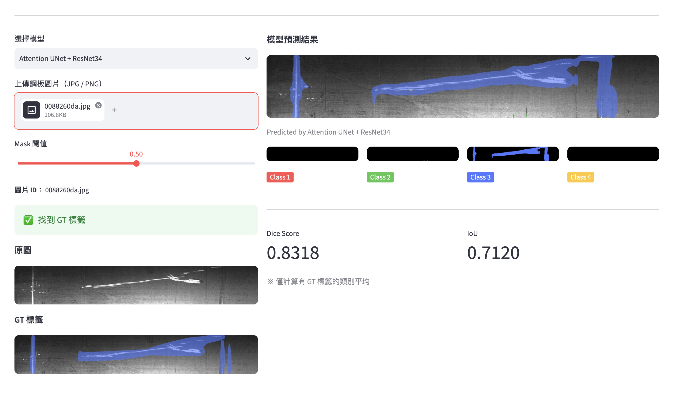

# Steel Plate Defect Segmentation

English | [中文](README.zh-TW.md)

Pixel-level segmentation of surface defects on steel plates using CSAD U-Net, an Attention U-Net variant with a shared encoder and attention gates.

**Live demo:** https://steeldefect-m5jqwkguuhhhjg9gkxkvyw.streamlit.app/



## Overview

The model takes a grayscale steel plate image as input and outputs segmentation masks for 4 defect classes. Three backbones were evaluated: ResNet34, EfficientNet-B4 and InceptionV3.

## Results

Generalization experiment, compared with the baseline from Aboulhosn et al. (2024).

| Backbone | Method | Macro DSC | Macro IoU |
|---|---|---|---|
| EfficientNet-B4 | Aboulhosn et al. (2024) | 0.7159 | 0.6977 |
| EfficientNet-B4 | **CSAD U-Net (Ours)** | **0.8347** | **0.8163** |
| ResNet34 | Aboulhosn et al. (2024) | 0.5467 | 0.5275 |
| ResNet34 | **CSAD U-Net (Ours)** | **0.7270** | **0.7083** |
| InceptionV3 | Aboulhosn et al. (2024) | 0.7468 | 0.7278 |
| InceptionV3 | **CSAD U-Net (Ours)** | **0.8458** | **0.8270** |

<details>
<summary>Per-class DSC</summary>

| Backbone | Method | Defect 1 | Defect 2 | Defect 3 | Defect 4 |
|---|---|---|---|---|---|
| EfficientNet-B4 | Aboulhosn et al. (2024) | 0.6736 | 0.7735 | 0.6230 | 0.7934 |
| EfficientNet-B4 | CSAD U-Net (Ours) | 0.8077 | 0.9172 | 0.6925 | 0.9215 |
| ResNet34 | Aboulhosn et al. (2024) | 0.3436 | 0.6103 | 0.4664 | 0.7662 |
| ResNet34 | CSAD U-Net (Ours) | 0.6508 | 0.8512 | 0.5427 | 0.8634 |
| InceptionV3 | Aboulhosn et al. (2024) | 0.6520 | 0.7736 | 0.6751 | 0.8865 |
| InceptionV3 | CSAD U-Net (Ours) | 0.8464 | 0.9328 | 0.6685 | 0.9358 |

</details>

<details>
<summary>Per-class IoU</summary>

| Backbone | Method | Defect 1 | Defect 2 | Defect 3 | Defect 4 |
|---|---|---|---|---|---|
| EfficientNet-B4 | Aboulhosn et al. (2024) | 0.6630 | 0.7706 | 0.5717 | 0.7856 |
| EfficientNet-B4 | CSAD U-Net (Ours) | 0.7970 | 0.9144 | 0.6406 | 0.9133 |
| ResNet34 | Aboulhosn et al. (2024) | 0.3326 | 0.6075 | 0.4121 | 0.7576 |
| ResNet34 | CSAD U-Net (Ours) | 0.6405 | 0.8484 | 0.4894 | 0.8550 |
| InceptionV3 | Aboulhosn et al. (2024) | 0.6410 | 0.7708 | 0.6214 | 0.8780 |
| InceptionV3 | CSAD U-Net (Ours) | 0.8361 | 0.9300 | 0.6148 | 0.9271 |

</details>

DSC and IoU are macro-averaged over classes that have ground truth labels.

## Dataset

[Severstal: Steel Defect Detection](https://www.kaggle.com/c/severstal-steel-defect-detection) (Kaggle) — 4 defect classes, 1600 × 256 images (resized to 800 × 128), pixel-level RLE annotations. The dataset is not included in this repository.

## Run Locally

```bash
conda create -n steel python=3.11 -y
conda activate steel
pip install -r requirements.txt
python -m streamlit run app.py
```

Models were trained with **TensorFlow 2.21.0 / Keras 3.13.2**; other Keras versions may fail to load them. Model weights are hosted on Google Drive and downloaded automatically on first use.
